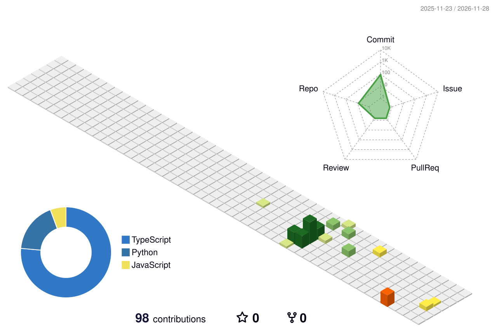
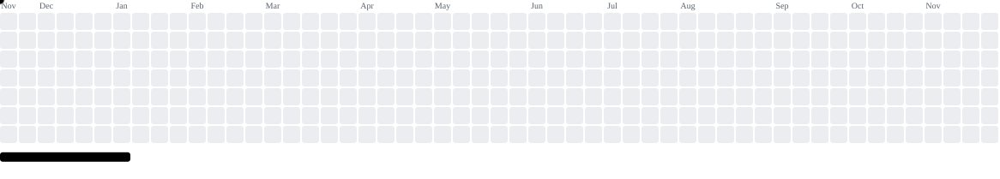
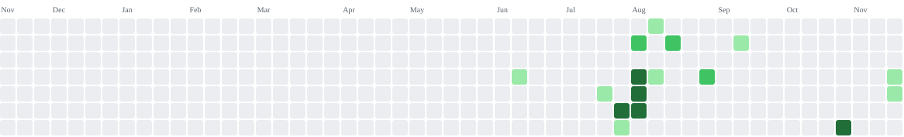

<p align="center">
  
</p>

<h3 align="center">
  Hi there
  
</h3>

<p align="center">
  
</p>

<p align="center">
  
  <a href="https://github.com/aadithya5675-collab?tab=followers"></a>
</p>


##  About me

```yaml
name:      Aadithya G
role:      Robotics & full-stack developer
building:  [autonomous rovers, drone swarms, web apps]
robotics:  ROS 2 Jazzy · Raspberry Pi 5 · RPLIDAR · Gazebo
web:       React · Next.js · TypeScript · Supabase · GSAP
```

##  Spotlight: ResQMesh

<p align="center">
  
</p>

> Built by Team Apex for **Hack-Orbital 2026** (Conscientia, IIST Thiruvananthapuram), problem statement S.3.

<p align="left">
  <a href="https://drone-swarm-s3.vercel.app"></a>
  <a href="https://github.com/aadithya5675-collab/drone-swarm-s.3"></a>
</p>

##  Featured projects

<p align="center">
  <a href="https://github.com/aadithya5675-collab/drone-swarm-s.3"></a>
  <a href="https://github.com/aadithya5675-collab/rover_obstacle_avoidance"></a>
  <a href="https://github.com/aadithya5675-collab/e-Yantra"></a>
  <a href="https://github.com/aadithya5675-collab/suyambu-travels"></a>
  <a href="https://github.com/aadithya5675-collab/dhasvika-travels"></a>
  <a href="https://github.com/aadithya5675-collab/forge-gym-membership"></a>
</p>

##  Tech stack

**Languages**<br/>


**Robotics & systems**<br/>


**Web & cloud**<br/>


**Tools**<br/>


##  GitHub stats

<p align="center">
  
  
</p>

<p align="center">
  
</p>

<p align="center">
  
</p>

<p align="center">
  
</p>

##  Contribution arcade

<p align="center">
  <picture>
    <source media="(prefers-color-scheme: dark)" srcset="https://raw.githubusercontent.com/aadithya5675-collab/aadithya5675-collab/output/github-snake-dark.svg"/>
    
  </picture>
</p>

<p align="center">
  <picture>
    <source media="(prefers-color-scheme: dark)" srcset="https://raw.githubusercontent.com/aadithya5675-collab/aadithya5675-collab/output/pacman-contribution-graph-dark.svg"/>
    
  </picture>
</p>

<p align="center">
  <picture>
    <source media="(prefers-color-scheme: dark)" srcset="https://raw.githubusercontent.com/aadithya5675-collab/aadithya5675-collab/output/breakout-contribution-graph-dark.svg"/>
    
  </picture>
  <picture>
    <source media="(prefers-color-scheme: dark)" srcset="https://raw.githubusercontent.com/aadithya5675-collab/aadithya5675-collab/output/tetris-contribution-graph-dark.svg"/>
    
  </picture>
</p>

<p align="center">
  
</p>
